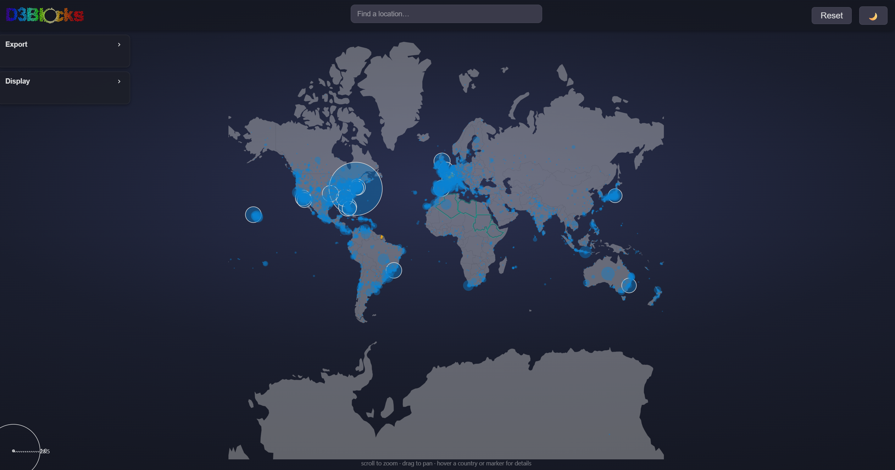
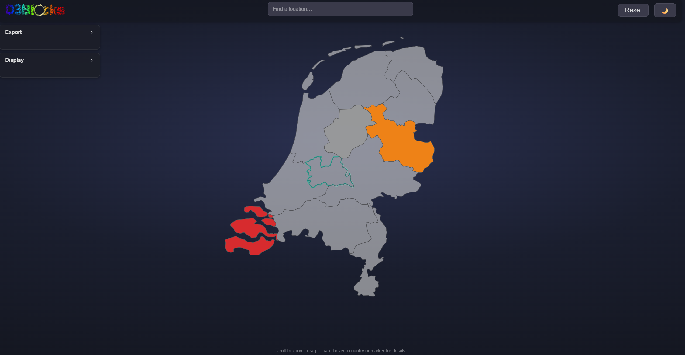
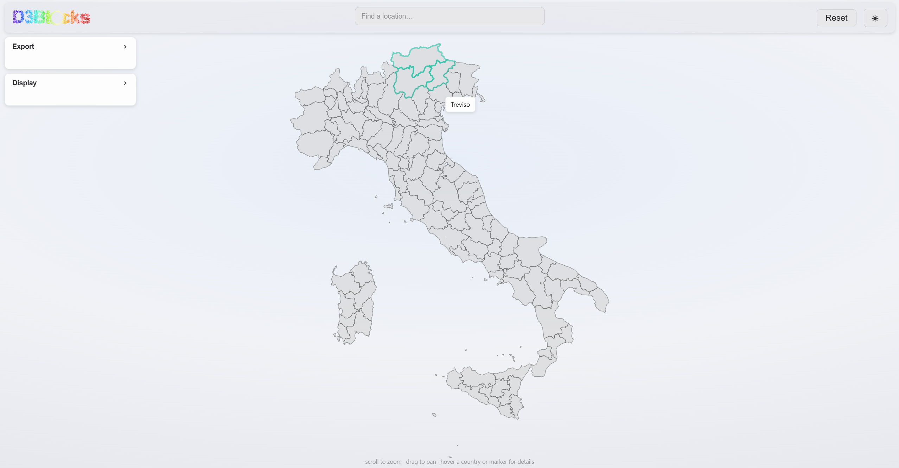

# worldmap

[](https://img.shields.io/pypi/pyversions/d3blocks)
[](https://pypi.org/project/d3blocks/)
[](https://d3blocks.github.io/d3blocks/)
[](https://github.com/d3blocks/d3blocks/)
[](https://pepy.tech/project/d3blocks)
[](https://pepy.tech/project/d3blocks)
[](https://github.com/d3blocks/d3blocks/blob/master/LICENSE)
[](https://github.com/d3blocks/d3blocks/network)
[](https://github.com/d3blocks/d3blocks/issues)
[](http://www.repostatus.org/#active)
[](https://d3blocks.github.io/d3blocks/pages/html/Documentation.html#medium-blog)


[](https://d3blocks.github.io/d3blocks/pages/html/Documentation.html#colab-notebook)
[](https://d3blocks.github.io/d3blocks/pages/html/Documentation.html#)


An interactive, D3-based world and regional map visualization for Python.

The `worldmap` package (Maps) renders interactive maps using D3 code forked from Mike Bostock and adapted for Python. It supports coloring countries, drawing borders, and plotting latitude/longitude markers (for example, surf spots) with configurable size, color, opacity and labels. Output is generated as a self-contained HTML file you can open in a browser or embed in Jupyter.

Homepage / source: https://github.com/erdogant/worldmap

---

## Features

- Color countries (world or regional maps) using explicit colors or colormaps
- Place markers (scatter circles) by latitude/longitude with configurable size, color, opacity and labels
- Save interactive output as an HTML file or return HTML for embedding
- Optionally display a Save button in the generated HTML to export the chart as SVG
- Simple imperative API for one-shot plotting or stepwise configuration

---

## Installation

Install directly from pypi:

```
pip install worldmap
```

Or clone the repository and install with your preferred method.

Dependencies (typical): pandas, numpy. See the repository `requirements.txt` for a full list.

---


## Example figures

Below are example screenshots that illustrate typical outputs from `worldmap`.

> Note: the repository does not include these images by default. Add your example images to `docs/images/` with the filenames shown below or update the paths if you store them elsewhere.


Global map with markers (dark theme)



Dutch provinces (regional map, dark theme)



Italy provinces (light theme)




If you'd like, I can add these image files to the repository for you — either by uploading them here (paste or attach the files) or by fetching them from URLs you provide.


---

## Quick start

Basic usage (one-liner):

```py
from worldmap import worldmap

d3 = worldmap()
df = d3.import_example(data='surfspots')   # example data included with the package
d3.maps(df)                                # show map with markers
```

If you prefer a stepwise workflow:

```py
from worldmap import worldmap

d3 = worldmap(chart='maps', frame=False)
d3.set_node_properties(df)
d3.set_edge_properties(country_names=['Netherlands', 'Belgium'], cmap='Set2')
d3.show()
```


Examples below are taken from `worldmap/examples.py` in the repository.

- Markers only

```py
from worldmap import worldmap

d3 = worldmap()
df = d3.import_example(data='surfspots')
d3.maps(df)
```

- Country coloring (worldmap-style) without markers

```py
from worldmap import worldmap

d3 = worldmap()
d3.maps(country_names=['Netherlands', 'France', 'Germany'], cmap='Set1')
```

- Regional map: Dutch provinces

```py
from worldmap import worldmap

d3 = worldmap()
d3.maps(country_names=['Zeeland', 'Overijssel', 'Flevoland'], map_name='netherlands', cmap='Set1')
```

- Countries + values (opacity scaled) + markers

```py
from worldmap import worldmap

d3 = worldmap()
df = d3.import_example(data='surfspots')
d3.maps(df, country_names=['Netherlands', 'Australia', 'USA'], country_values=[10, 5, 20], cmap='Blues')
```

- Explicit countries dict

```py
from worldmap import worldmap

d3 = worldmap()
d3.maps(df,
        countries={
            'World': {'color': '#D3D3D3', 'opacity': 0.4, 'line': 'none', 'linewidth': 0.1},
            'Netherlands': {'color': '#000FFF', 'opacity': 0.5},
            'France': {'color': '#FFA500', 'opacity': 1, 'line': 'dashed', 'linewidth': 2},
        })
```

- Stepwise workflow

```py
from worldmap import worldmap

d3 = worldmap(chart='maps', frame=False)
d3.set_node_properties(df)
d3.set_edge_properties(country_names=['Netherlands', 'Belgium'], cmap='Set2')
d3.show()
```


---

## Returns / accessible properties

The worldmap object exposes the following (when applicable):

- `d3.node_properties` — DataFrame or structure with properties for unique input labels / nodes
- `d3.edge_properties` — DataFrame or structure with properties for unique edges / links
- `d3.config` — dictionary containing configuration properties

Note: `maps` itself either writes/opens an HTML file or returns an HTML string when `return_html=True`.


---

## Notebook usage

Set `notebook=True` to attempt inline display in a Jupyter notebook. Alternatively, `return_html=True` lets you capture the HTML string and embed it manually.

---

## Development & Contributing

- Clone the repository: `git clone https://github.com/erdogant/worldmap.git`
- Run the example scripts in `worldmap/examples.py` to see usage patterns
- If you add features or fix bugs, open a pull request with tests or example updates where appropriate

---

## Contact

Author: E. Taskesen
Email: erdogant@gmail.com
Repository: https://github.com/erdogant/worldmap

---

## License

See the repository for license details.
